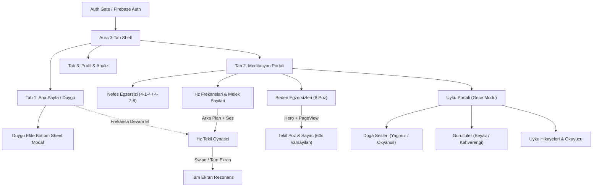

# MediTrans — State, Navigation & Stitch Feature Reference

This reference documents the screen hierarchy, Stitch-to-Flutter route mapping, domain models, and runtime state machines for scaffolding MediTrans features.

> **Design Constraint:** MediTrans contains **NO mascot or GIF character** anywhere in the app. Emotional tracking relies exclusively on Ethereal Aura Mind glass surfaces, soft ambient aura orbs, clean icons, and emoji chips (`☀️`, `🌿`, `🕊️`, `🌪️`, `🌙`, `🔥`, `🌧️`).

---

## 1. Navigation Topology (3-Tab Shell + Focus Sub-Routes)

MediTrans uses a **floating 3-tab frosted glass bottom navigation bar** (`radius: 28px`) for top-level destinations, paired with distraction-free sub-routes for active meditation, resonance, and sleep players.



---

## 2. Stitch Folder to Flutter Route & Feature Mapping

| # | Stitch Folder (`stitch_meditasyon_uygulamas_aray_z/...`) | Feature Module | Route | Theme Mode |
| :--- | :--- | :--- | :--- | :--- |
| 1 | `ana_sayfa_duygu_durumu` | `home_mood` | `/home` (Tab 0) | Light (`#FBF8FF`) |
| 2 | `meditasyon_portali_4_kategori` | `meditation` | `/meditation` (Tab 1) | Light (`#FBF8FF`) |
| 3 | `profil_ve_duygu_analizi` | `profile` | `/profile` (Tab 2) | Light (`#FBF8FF`) |
| 4 | `nefes_egzersizleri_kompakt_oynat_c` | `breathwork` | `/meditation/breath` | Light + Orb |
| 5 | `beden_egzersizleri_yoga_portal` | `body_exercises` | `/meditation/body` | Light |
| 6 | `sasangasana_egzersiz_ve_saya_detay` | `body_exercises` | `/meditation/body/:poseId` | Light |
| 7 | `hz_frekanslar_ve_meditasyon_tonlar` | `frequencies` | `/meditation/hz` | Light / Aura |
| 8 | `hz_frekans_oynat_c` | `frequencies` | `/meditation/hz/:freqId` | Dynamic Aura |
| 9 | `hz_frekans_oynat_c_tam_ekran_rezonans` | `frequencies` | `/meditation/hz/:freqId/fullscreen` | Cosmic / Dynamic |
| 10 | `uyku_portal_kategoriler` | `sleep` | `/meditation/sleep` | Night (`#0E111C`) |
| 11 | `do_a_sesleri_ses_oynat_c` | `sleep` | `/meditation/sleep/nature` | Night (`#0E111C`) |
| 12 | `g_r_lt_mikseri_beyaz_kahverengi_g_r_lt` | `sleep` | `/meditation/sleep/noise` | Night (`#0E111C`) |
| 13 | `uyku_hikayeleri_sabit_kompakt_oynat_c` | `sleep` | `/meditation/sleep/stories` | Night (`#060814`) |

---

## 3. Canonical Domain Contracts

```dart
// 1. Emoji Mood Preset & Daily Mood Log (`ana_sayfa_duygu_durumu`)
class MoodTag {
  final String emoji;              // e.g. '☀️', '🌿', '🕊️', '🌪️', '🌙', '🔥'
  final String label;              // e.g. 'Mutlu', 'Dingin', 'Huzurlu', 'Kaygılı', 'Yorgun', 'Kızgın'
  final Color chipColor;
}

class MoodLogEntry {
  final DateTime dateKey;          // yyyy-MM-dd normalized
  final List<MoodTag> selectedTags;
  final String note;               // Quick reflection note (`+ Eklemek istediklerim...`)
  final double? score;             // Weekly chart point (e.g. 4.8..9.4 in `profil_ve_duygu_analizi`)
}

// 2. Parametric Breathwork Cadence (supports both Stitch 4-1-4 and existing 4-7-8 mp3)
class BreathCadence {
  final String id;                 // '4-1-4' | '4-7-8'
  final String title;
  final int inhaleSeconds;         // 4 | 4
  final int holdSeconds;           // 1 | 7
  final int exhaleSeconds;         // 4 | 8
  final String? audioAssetPath;
}

// 3. Body Exercise Pose (8 poses mapped to BEDEN-EGZERSIZI-POZISYON1..8.png)
class BodyPose {
  final String id;                 // 'virasana', 'sasangasana', ...
  final int orderIndex;            // 1..8
  final String sanskritName;
  final String turkishName;
  final String imageAssetPath;     // Hero tag: 'pose_hero_$id'
  final List<String> steps;        // 3 numbered guidance steps
  final int defaultSeconds;        // 60
}

// 4. Frequency / Angel Track (each item binds its own background + tone audio)
class FrequencyTrack {
  final String id;                 // '396', '432', '528', ..., '7.83', '111'..'999'
  final String label;              // '528 Hz' or '999'
  final String subtitle;           // 'Mucize Frekansi'
  final Color accentColor;
  final String previewImageAsset;  // Shown inside list card slice & static backdrop
  final String? motionAssetOrUrl;  // Lightweight loop / shader config / Storage URL
  final String? audioAssetOrUrl;
}

// 5. Sleep Story (Title above player, scrollable text synced with audio)
class SleepStory {
  final String id;                 // 'hikaye_1', 'hikaye_2'
  final String title;
  final String backdropAsset;
  final String audioAsset;
  final String textAsset;          // Loaded into Cormorant Garamond reader
}
```

---

## 4. Core State Flows & Behavioral Rules

### 4.1 Home / Daily Mood Flow (`ana_sayfa_duygu_durumu`)
1. **Header & Weekly Rhythm:** Displays greeting (`Merhaba, <Ad>`) + sub-caption (`Bugün ruhunun nefes almasına izin ver.`) and the 7-day strip (`P S Ç P C C P`, day numbers + mood indicator dot underneath).
2. **Mood Chips Card (`Nasıl Hissediyorsun?`):** Displays removable active emoji chips (`🔥 Kızgın`, `🌧️ Üzgün`, etc. with `×` remove action), `+ Duygu Ekle` pill button, and quick reflection input (`+ Eklemek istediklerim...`).
3. **Modal Bottom Sheet (`Bugün Ne Hissediyorsun?`):** Tapping `+ Duygu Ekle` opens a frosted sheet (`borderRadius: BorderRadius.vertical(top: Radius.circular(32))`) with a 3x2 grid of emoji options (`☀️ Mutlu`, `🌿 Dingin`, `🕊️ Huzurlu`, `🌪️ Kaygılı`, `🌙 Yorgun`, `🔥 Kızgın`), optional note input, and `Duygu Durumunu Kaydet`. Saves to local state + Firestore (`users/{uid}/mood_logs/{yyyy-MM-dd}`).
4. **Frekansa Devam Et Card:** Displays the currently queued/resumed meditation frequency (`432 Hz Solfeggio`) with inline Play/Pause, skip, and scrubber synchronized with `GlobalAudioController`.

### 4.2 Universal Persistent Audio Player (`GlobalAudioController`)
- **Single Source of Truth:** A single `ChangeNotifier` / state controller owns playback across tabs and sub-screens.
- **Required Transport Controls on Every Audio Screen:**
  - `Play / Pause` toggle button
  - `Seek Backward / Forward` (`-10s` / `+10s`, or `Previous / Next` when in playlist/swipe context)
  - Elapsed time (`MM:SS`), total duration (`MM:SS`), and interactive seek slider
  - Optional `Favorite`, `Sleep Timer` (`15 / 30 / 45 / 60 dk`), `Volume` & `Close / Stop` button
- **Background Persistence Rule:** Popping a player screen or switching tabs (`Ana Sayfa`, `Meditasyon`, `Profil`) MUST NOT stop active audio playback.

### 4.3 Breathwork Cadence State (`nefes_egzersizleri_kompakt_oynat_c`)
- **Cycle Phases:** `inhale` (`"Nefes Al"` — scale orb `0.65 -> 1.0`) -> `hold` (`"Nefesini Tut"` — pulse glow) -> `exhale` (`"Yavaşça Ver"` — scale orb `1.0 -> 0.65`).
- **Default Cadence:** `4-1-4` (matching Stitch screen labels); switchable to `4-7-8` if pairing with `4-7-8_Nefes_Egzersizi.mp3`.
- **Safe Area:** Reserve at least `96px` at bottom for the compact player bar + floating safe zone.

### 4.4 Body Exercise Hero & Countdown (`beden_egzersizleri_yoga_portal` -> `sasangasana_egzersiz_ve_saya_detay`)
1. Tapping any borderless pose card navigates with `Hero(tag: 'pose_hero_${pose.id}')` to the detail `PageView`.
2. Users can swipe left/right or tap prev/next chevrons to move across all 8 poses (`01 Virasana` through `08 Savasana`).
3. **Timer Behavior:** Defaults to `60s` radial countdown ring (`48px` light tabular figures). Includes quick preset pills (`10s`, `20s`, `30s`, `60s`, `90s`), `+5s` increment, chime sound toggle, and completion prompt/advance to the next pose.

### 4.5 Frequencies List & Swipeable Resonance (`hz_frekanslar_*`)
1. **List Preview Rule:** Every card renders a cropped/tinted strip of that frequency's own backdrop texture so users visually preview the frequency's aura before tapping.
2. **Swipe Sync Rule:** Inside the single/fullscreen player (`PageView.builder`), changing pages immediately transitions both the layered background visual (static image + GPU shimmer/pulse by default; lightweight loop/stream if enabled) and the active audio track via `GlobalAudioController`.

### 4.6 Sleep Module Switchers & Story Layout (`uyku_*`)
- **Theme:** Uses dark cosmic tokens (`#0E111C` / `#060814`, `#181D2D` card base, `rgba(255, 255, 255, 0.20)` borders).
- **Nature & Noise Single-Channel Switchers:**
  - Nature toggles between `Gece Yağmuru` and `Derin Okyanus`.
  - Noise toggles between `Beyaz Gürültü` and `Kahverengi Gürültü`.
  - Switching updates both the full-bleed backdrop image and audio source atomically.
- **Sleep Stories Hierarchy:** Story title renders **above** the player controls; the scrollable story narrative (set in `Cormorant Garamond`, `17–19px`, line-height `1.7`) flows cleanly without obscuring the sticky compact player controls.

### 4.7 Profile & Weekly Emotion Curve (`profil_ve_duygu_analizi`)
- Displays user identity (`Mindful Gezgin`), vital stats (**Yaş**, **Kilo**), habit pills (**Alışkanlıklar & Rutinler**), **Haftalık Analiz Duygu Grafiği** smooth cubic spline chart with 7-day emoji indicators + scores, reminder notification toggles, account settings, and Firebase **Çıkış Yap**.

---

## 5. Multi-Platform Persistence, Cloud Storage & Notifications

See [data_referance.md](../../../../data_referance.md) for complete schemas and seed rows.

### 5.1 Offline-First Write & Sync Pipeline (`Drift` + `sync_outbox` + `Firestore`)
1. User edits (`mood_logs`, `user_profiles`, `habit_routines`, `reminder_schedules`) write immediately to local **Drift** SQLite (native macOS/mobile) or SQLite-WASM/IndexedDB (Windows Web `Chrome` / `web-server`).
2. Simultaneously enqueue a compact JSON payload into `sync_outbox`.
3. `SyncCoordinator` flushes pending rows to Firebase `Firestore` whenever online and marks `sync_status = synced`.
4. Player runtime micro-state (`last_media_id`, `last_position_ms`) reads/writes from lightweight `hive_ce` / `shared_preferences`.

### 5.2 Free-Tier Cloud Storage Resolver (`Supabase Storage` + Native LRU Cache)
- **Zero-Cost Plan Rule:** Do **not** add `firebase_storage` (requires paid Firebase Blaze plan). Keep Firebase on the free **Spark** tier (`firebase_auth` without SMS/Phone, `cloud_firestore`, `firebase_messaging`) and host all remote audio/visuals in **Supabase Storage** (Free: 1 GB storage, 10 GB/month egress = 5 GB uncached + 5 GB cached).
- **`MediaStorageGateway`** resolves playback URIs in order:
  1. **Bundled Light Asset:** Immediate small in-app chimes/static images (`assets/`).
  2. **Native Cache Hit (macOS/iOS/Android only):** Check `cached_media` table -> return verified `file://` path (saves Supabase egress).
  3. **Remote Catalog (`Supabase Storage`):** Fetch CDN/signed HTTPS URL from `meditation-audio` / `meditation-visuals` with HTTP `Range` support for scrubbing; native targets download & pin to LRU cache on first play.
- **Platform Guard:** Use conditional exports (`media_cache_io.dart` vs `media_cache_web.dart`) so Web (`Chrome`/`web-server`) never imports `dart:io`.

### 5.3 Notification Routing (`firebase_messaging` + `flutter_local_notifications`)
- **`NotificationGateway`** abstracts platform differences:
  - **macOS / Android / iOS:** Schedules offline recurring reminders via `flutter_local_notifications` (`zonedSchedule`) and handles foreground/background FCM pushes (`onMessage`, `onMessageOpenedApp`) with APNs configured on Apple targets.
  - **Windows Web (`Chrome` / `web-server`):** Skips `flutter_local_notifications` (unsupported on Web), registers `web/firebase-messaging-sw.js` + VAPID token with `firebase_messaging` for remote Web Push, and renders in-app Aura banners for active-tab reminders.
  - **Native Windows (optional guard):** Disables `firebase_messaging` cleanly if `!kIsWeb && defaultTargetPlatform == TargetPlatform.windows`.
