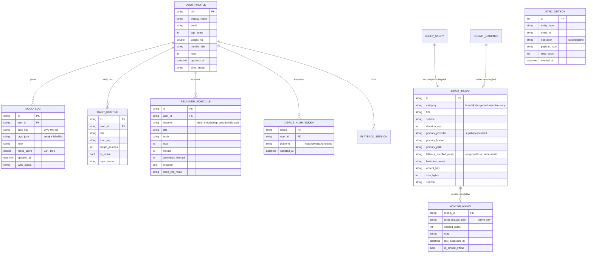

# MediTrans — Veri Modelleri, Depolama Şeması ve Referans Rehberi (`data_referance.md`)

Bu doküman; **MediTrans** uygulamasının çevrimdışı-öncelikli yerel veritabanı (`Drift` + `hive_ce`), ücretsiz bulut katmanı (**Firebase Spark**: Auth + Firestore + FCM + **Supabase Free**: Storage + Postgres Manifest), bildirim yükleri (`FCM` + `flutter_local_notifications`) ve tüm ekran veri sözleşmeleri için tek doğruluk kaynağıdır.

> **Önemli Kurallar:**
> 1. **Sıfır Ücretli Bulut Bağımlılığı:** Cloud Storage for Firebase, Phone/SMS Auth ve Cloud Functions Blaze (ücretli/fatura hesabı) planı gerektirdiğinden **kullanılmaz**. Tüm uzak ses/görsel dosya depolaması **Supabase Storage** üzerinde, kullanıcı verileri + kimlik + push bildirimleri **Firebase Spark** (Auth, Firestore, FCM) üzerinde yürütülür.
> 2. **Maskotsuz Tasarım:** Uygulamada maskot veya GIF karakter modeli yoktur; ruh hali kayıtları yalnızca **emoji + etiket + yansıma notu + sayısal skor** yapısındadır.
> 3. **Çapraz Platform Güvenliği:** Tüm modeller **macOS** (native App Sandbox) ve **Windows Web** (`Chrome` / `web-server`) ortamlarında `dart:io` bağımlılığı olmadan serileştirilebilir (`toJson` / `fromJson`) tasarlanmıştır.

---

## 1. Varlık İlişki Diyagramı (ERD)



---

## 2. Çekirdek Dart Veri Modelleri

### 2.1 Senkronizasyon & Sağlayıcı Enum'ları

```dart
enum SyncStatus {
  synced,
  pendingUpsert,
  pendingDelete,
  failed,
}

enum StorageProvider {
  bundledAsset,
  supabaseStorage,
}

enum MediaCategory {
  breathwork,
  frequencyHz,
  angelNumber,
  natureSound,
  noise,
  sleepStory,
}

enum AppPlatformTarget {
  macOS,
  webChromeOrServer,
  android,
  iOS,
  windowsDesktop,
}
```

### 2.2 Kullanıcı Profili & Alışkanlıklar (`profil_ve_duygu_analizi`)

```dart
class UserProfileModel {
  const UserProfileModel({
    required this.uid,
    required this.displayName,
    this.email,
    this.ageYears,
    this.weightKg,
    this.mindfulTitle = 'Mindful Gezgin',
    this.level = 1,
    this.preferredSleepTimerMinutes = 30,
    required this.updatedAt,
    this.syncStatus = SyncStatus.pendingUpsert,
  });

  final String uid;
  final String displayName;
  final String? email;
  final int? ageYears;                 // Örn: 28 yıl
  final double? weightKg;              // Örn: 74 kg
  final String mindfulTitle;           // Örn: "Mindful Gezgin"
  final int level;                     // Örn: Seviye 3
  final int preferredSleepTimerMinutes;
  final DateTime updatedAt;
  final SyncStatus syncStatus;
}

class HabitRoutineModel {
  const HabitRoutineModel({
    required this.id,
    required this.userId,
    required this.title,
    required this.iconKey,
    this.targetMinutesPerDay = 15,
    this.isActive = true,
    this.syncStatus = SyncStatus.pendingUpsert,
  });

  final String id;
  final String userId;
  final String title;                  // Örn: "Günlük 15 dk meditasyon"
  final String iconKey;                // 'self_improvement' | 'nights_stay' | 'air'
  final int targetMinutesPerDay;
  final bool isActive;
  final SyncStatus syncStatus;
}
```

### 2.3 Duygu Durumu & Haftalık Grafik (`ana_sayfa_duygu_durumu`, `profil_ve_duygu_analizi`)

```dart
class MoodPreset {
  const MoodPreset({
    required this.id,
    required this.emoji,
    required this.label,
    required this.defaultScore,
    required this.chipColorHex,
    required this.textColorHex,
  });

  final String id;
  final String emoji;                  // '☀️', '🌿', '🕊️', '🌪️', '🌙', '🔥', '🌧️'
  final String label;                  // 'Mutlu', 'Dingin', 'Huzurlu', 'Kaygılı', 'Yorgun', 'Kızgın', 'Üzgün'
  final double defaultScore;           // 0.0 - 10.0 aralığında grafik karşılığı
  final int chipColorHex;
  final int textColorHex;
}

class DailyMoodLogModel {
  const DailyMoodLogModel({
    required this.id,                  // '${userId}_$dateKey'
    required this.userId,
    required this.dateKey,             // 'yyyy-MM-dd' (Örn: '2024-10-12')
    required this.selectedMoodIds,     // En fazla önerilen 3 aktif etiket
    this.note = '',
    required this.computedScore,       // 4.8 .. 9.4 (haftalık spline grafiği noktası)
    required this.updatedAt,
    this.syncStatus = SyncStatus.pendingUpsert,
  });

  final String id;
  final String userId;
  final String dateKey;
  final List<String> selectedMoodIds;
  final String note;
  final double computedScore;
  final DateTime updatedAt;
  final SyncStatus syncStatus;
}
```

### 2.4 Medya Kataloğu, Bulut Depolama & Yerel Önbellek Modeli

```dart
class StorageObjectLocation {
  const StorageObjectLocation({
    required this.provider,
    required this.bucket,
    required this.objectPath,
  });

  final StorageProvider provider;      // supabaseStorage | bundledAsset
  final String bucket;                 // Supabase: 'meditation-audio' | 'meditation-visuals' (bundled'da '')
  final String objectPath;             // Örn: 'nature/5dk_sakin_yagmur.mp3'
}

class MediaTrackModel {
  const MediaTrackModel({
    required this.id,
    required this.category,
    required this.title,
    required this.subtitle,
    required this.durationMs,
    required this.primarySource,
    this.fallbackBundledAsset,
    this.backdropAssetOrPath,
    this.motionLoopSource,
    required this.accentColorHex,
    required this.sizeBytes,
    this.sha256,
    this.catalogVersion = 1,
  });

  final String id;
  final MediaCategory category;
  final String title;
  final String subtitle;
  final int durationMs;
  final StorageObjectLocation primarySource;
  final String? fallbackBundledAsset;  // Çevrimdışı ilk açılış / acil durum hafif yerel asset yolu
  final String? backdropAssetOrPath;   // Küçük önizleme görseli veya arka plan görseli
  final StorageObjectLocation? motionLoopSource; // Opsiyonel hafif (<1 MB) arka plan döngüsü
  final int accentColorHex;
  final int sizeBytes;
  final String? sha256;
  final int catalogVersion;
}

class CachedMediaModel {
  const CachedMediaModel({
    required this.mediaId,
    required this.localRelativePath,   // Native (macOS/iOS/Android) alt yolu; Web'de boş string
    required this.cachedBytes,
    this.etag,
    required this.lastAccessedAt,
    this.isPinnedOffline = false,
  });

  final String mediaId;
  final String localRelativePath;
  final int cachedBytes;
  final String? etag;
  final DateTime lastAccessedAt;
  final bool isPinnedOffline;
}
```

### 2.5 Nefes, Yoga & Uyku Hikayesi Modelleri

```dart
class BreathCadenceModel {
  const BreathCadenceModel({
    required this.id,                  // '4-1-4' | '4-7-8'
    required this.title,
    required this.inhaleSeconds,
    required this.holdSeconds,
    required this.exhaleSeconds,
    this.linkedMediaId,
  });

  final String id;
  final String title;
  final int inhaleSeconds;
  final int holdSeconds;
  final int exhaleSeconds;
  final String? linkedMediaId;
}

class BodyPoseModel {
  const BodyPoseModel({
    required this.id,
    required this.orderIndex,          // 1..8
    required this.sanskritName,
    required this.turkishName,
    required this.imageAsset,          // Örn: 'assets/images/yoga/pozisyon_1.png'
    this.defaultDurationSeconds = 60,
    required this.steps,               // 3 adımlı yönlendirme
  });

  final String id;
  final int orderIndex;
  final String sanskritName;
  final String turkishName;
  final String imageAsset;
  final int defaultDurationSeconds;
  final List<String> steps;
}

class SleepStoryModel {
  const SleepStoryModel({
    required this.id,                  // 'hikaye_1' | 'hikaye_2'
    required this.title,
    required this.mediaTrackId,
    required this.backdropPath,
    required this.storyTextAsset,
    required this.estimatedMinutes,
  });

  final String id;
  final String title;
  final String mediaTrackId;
  final String backdropPath;
  final String storyTextAsset;
  final int estimatedMinutes;
}
```

### 2.6 Bildirim & Giden Kutusu Modelleri

```dart
class ReminderScheduleModel {
  const ReminderScheduleModel({
    required this.id,
    required this.userId,
    required this.channel,             // 'daily_mood' | 'sleep_winddown' | 'breath_break'
    required this.title,
    required this.body,
    required this.hour,                // 0..23
    required this.minute,              // 0..59
    this.weekdaysBitmask = 127,        // 7 gün bitmask (Pzt=1 .. Paz=64)
    this.isEnabled = true,
    this.deepLinkRoute = '/home',
  });

  final String id;
  final String userId;
  final String channel;
  final String title;
  final String body;
  final int hour;
  final int minute;
  final int weekdaysBitmask;
  final bool isEnabled;
  final String deepLinkRoute;
}

class PushNotificationEnvelope {
  const PushNotificationEnvelope({
    required this.messageId,
    required this.title,
    required this.body,
    required this.route,
    this.mediaId,
    required this.receivedAt,
  });

  final String messageId;
  final String title;
  final String body;
  final String route;                  // Örn: '/meditation/sleep/stories'
  final String? mediaId;               // Örn: 'hikaye_1'
  final DateTime receivedAt;
}
```

---

## 3. Veritabanı ve Depolama Katmanı Şemaları

### 3.1 Yerel SQLite / WASM Şeması (`Drift` — Önerilen Ana Yerel Veritabanı)

| Tablo Adı | Birincil Anahtar | İndekslenen Sütunlar | Kullanım Amacı |
| :--- | :--- | :--- | :--- |
| `user_profiles` | `uid` | `updated_at` | Kullanıcı yaş, kilo, unvan ve seviye bilgisi |
| `habit_routines` | `id` | `user_id`, `is_active` | Profil ekranındaki günlük alışkanlık çipleri |
| `mood_logs` | `id` | `(user_id, date_key) UNIQUE`, `sync_status` | Takvim günleri ve haftalık spline duygu grafiği sorguları |
| `media_catalog` | `id` | `category`, `catalog_version` | Uzak/yerel seslerin sürüm, boyut ve URL çözümleme kataloğu |
| `cached_media` | `media_id` | `last_accessed_at`, `is_pinned_offline` | Native (macOS/mobil) indirilen seslerin LRU önbellek indeksi |
| `reminder_schedules` | `id` | `user_id`, `is_enabled` | `flutter_local_notifications` için tekrarlayan hatırlatıcılar |
| `sync_outbox` | `id (AUTOINCREMENT)` | `created_at`, `entity_type` | Çevrimdışı değişikliklerin bağlantı geldiğinde sırayla buluta aktarımı |

### 3.2 Hafif Anahtar-Değer Katmanı (`hive_ce` / `shared_preferences`)

Aşağıdaki geçici/hafif UI durumları için SQL sorgusu gerekmez; doğrudan `app_runtime_prefs` kutusunda saklanır:
- `last_media_id`: `'hz_432'` (`Ana Sayfa -> Frekansa devam et` kartı için)
- `last_position_ms`: `258000` (kalınan saniyeden devam)
- `last_sleep_nature_id`: `'nature_rain'` | `'nature_ocean'`
- `last_sleep_noise_id`: `'noise_white'` | `'noise_brown'`
- `web_soft_cache_index`: Windows Chrome / `web-server` üzerinde son görüntülenen katalog JSON meta verisi

### 3.3 Bulut Şeması — Firebase Spark Ücretsiz Plan (`meditrans-2ff48`)

> **Plan Sınırı (Blaze Yok):** Cloud Storage for Firebase, Cloud Functions ve Phone/SMS Auth Spark planında kullanılmaz (`firebase_storage` paketi projeye eklenmeyecektir).

#### Firestore Koleksiyon Hiyerarşisi *(Spark ücretsiz kota: 1 GiB veri, 50K okuma/gün, 20K yazma/gün)*
```text
users/{uid}
  ├── profile (displayName, ageYears, weightKg, mindfulTitle, level, updatedAt)
  ├── mood_logs/{yyyy-MM-dd} (selectedMoodIds, note, computedScore, updatedAt)
  ├── habits/{habitId} (title, iconKey, targetMinutesPerDay, isActive)
  ├── reminders/{reminderId} (channel, hour, minute, weekdaysBitmask, isEnabled, deepLinkRoute)
  └── push_tokens/{tokenHash} (token, platform, updatedAt)
```

> Not: Kullanıcı profil dışa aktarımları Firestore üzerinden JSON veya yerelden paylaşılabilir; ikili medya yüklemesi yalnızca Supabase Storage'da yapılır.

### 3.4 Bulut Şeması — Supabase Free Ücretsiz Plan (`Storage + Postgres Katalog`)

> **Kota ve Bant Genişliği Koruması:** Supabase Free planında **1 GB dosya depolama** ve toplam **10 GB/ay egress** (5 GB uncached + 5 GB cached) hakkı vardır. `Drift cached_media` disk önbelleği sayesinde kullanıcı aynı ses dosyasını sadece 1 kez indirir.

#### Storage Bucket Yapısı
1. **`meditation-audio`** *(Read: `TO anon, authenticated` CDN/imzalı okuma; Write: yalnızca admin)*:
   - `nature/5dk_sakin_yagmur.mp3`
   - `nature/deep_ocean_shortened.m4a`
   - `noise/beyaz_gurultu.mp3`
   - `noise/kahverengi_gurultu.m4a`
   - `stories/hikaye_1.mp3`
   - `stories/hikaye_2.mp3`
   - `breathwork/4_7_8_nefes_egzersizi.mp3`
   - `frequencies/*.mp3` *(eklenecek Hz tonları)*
2. **`meditation-visuals`** *(Read: CDN okuma; ağır ham video barındırılmaz)*:
   - `hz-loops/*.mp4` *(0.18–0.28 MB optimize mikro döngüler)*
   - `stories/*.webp`

> **Supabase Güvenlik Kuralları Checklist:**
> - İstemcide yalnızca `SUPABASE_URL` ve `SUPABASE_PUBLISHABLE_KEY` (veya `anon` key) kullanılır; `service_role` anahtarı asla Flutter uygulamasına konulmaz.
> - Storage veya Postgres RLS politikalarında deprecated `auth.role()` yerine `TO authenticated` / `TO anon` ve `(select auth.uid()) = user_id` kullanılır; `upsert` izinleri `SELECT + INSERT + UPDATE` politikalarını birlikte içermelidir.

---

## 4. Mevcut İçerik Tohum Verileri (Seed Matrix)

### 4.1 Stitch Emoji Duygu Kataloğu (`ana_sayfa_duygu_durumu`)
| `id` | Emoji | Etiket | Grafik Puanı | Chip Zemini (`hex`) | Metin (`hex`) |
| :--- | :---: | :--- | :---: | :--- | :--- |
| `mutlu` | `☀️` | Mutlu | `9.2` | `#E7DEFF` | `#4B3E76` |
| `dingin` | `🌿` | Dingin | `8.5` | `#C9E7CD` | `#324D39` |
| `huzurlu` | `🕊️` | Huzurlu | `8.8` | `#E7DEFF` | `#4B3E76` |
| `kaygili` | `🌪️` | Kaygılı | `5.0` | `#FFDBCD` | `#70361B` |
| `yorgun` | `🌙` | Yorgun | `5.5` | `#E4E7FF` | `#1A1D2B` |
| `kizgin` | `🔥` | Kızgın | `4.2` | `#FFC0A0` (40%) | `#8A4B2D` |
| `uzgun` | `🌧️` | Üzgün | `4.8` | `#E4E7FF` (80%) | `#60538D` |

### 4.2 Nefes Egzersizleri (`nefes_egzersizleri_kompakt_oynat_c`)
| `id` | Başlık | Ritim (`Al-Tut-Ver`) | Ses Kaynağı | Boyut | Hedef Sağlayıcı |
| :--- | :--- | :---: | :--- | :---: | :--- |
| `breath_4_1_4` | Denge Nefesi | `4-1-4` sn | Görsel küre + opsiyonel çan ipucu | — | Yerel / Hafif Asset |
| `breath_4_7_8` | Rahatlama Nefesi | `4-7-8` sn | `4-7-8_Nefes_Egzersizi.mp3` | `1.37 MB` | `supabaseStorage` (yerel disk önbellekli) |

### 4.3 Beden Egzersizleri — 8 Poz (`beden_egzersizleri_yoga_portal`, `sasangasana_egzersiz_ve_saya_detay`)
| Sıra | `id` | Sanskrit / İsim | Türkçe Alt Başlık | Görsel Kaynak (`SAYFALAR-ARKA-PLAN/...`) | Varsayılan Süre |
| :---: | :--- | :--- | :--- | :--- | :---: |
| `01` | `virasana` | Virasana | Kahraman Oturuşu | `BEDEN-EGZERSIZI-POZISYON1.png` | `60 sn` |
| `02` | `padmasana` | Padmasana | Lotus Duruşu | `BEDEN-EGZERSIZI-POZISYON2.png` | `60 sn` |
| `03` | `sukhasana` | Sukhasana | Huzur Bağdaşı | `BEDEN-EGZERSIZI-POZISYON3.png` | `60 sn` |
| `04` | `sasangasana` | Sasangasana | Tavşan & Esneme Pozu | `BEDEN-EGZERSIZI-POZISYON4.png` | `60 sn` |
| `05` | `vrikshasana` | Vrikshasana | Ağaç Dengesi | `BEDEN-EGZERSIZI-POZISYON5.png` | `60 sn` |
| `06` | `phalakasana` | Phalakasana | Plank & Güç | `BEDEN-EGZERSIZI-POZISYON6.png` | `60 sn` |
| `07` | `paschimottanasana` | Paschimottanasana | Oturarak Öne Katlanma | `BEDEN-EGZERSIZI-POZISYON7.png` | `60 sn` |
| `08` | `savasana` | Savasana | Derin Gevşeme & Bitiş | `BEDEN-EGZERSIZI-POZISYON8.png` | `60 sn` |

### 4.4 Hz Frekansları & Melek Sayıları (`hz_frekanslar_*`)
- **Solfeggio & Rezonans:** `7.83 Hz` (Schumann — `0.19 MB` loop), `44 Hz`, `174 Hz`, `285 Hz`, `396 Hz` (Kök Çakra — `0.21 MB` loop), `432 Hz` (Evrensel Uyum — `0.20 MB` loop), `528 Hz` (Mucize — `0.20 MB` loop), `639 Hz` (Kalp — `0.19 MB` loop), `741 Hz` (Boğaz — `0.28 MB` loop), `852 Hz` (Üçüncü Göz — `0.18 MB` loop), `963 Hz` (Tepe — `0.18 MB` loop).
- **Melek Sayıları (3x3 Izgara Stili):** `111` (Sezgi), `222` (Uyum), `333` (Destek), `444` (Koruma), `555` (Değişim), `666` (Yansıma), `777` (Şans), `888` (Denge), `999` (Arınma/Bırakma — `0.21 MB` loop).
- **Not:** Bu kalemlerin görsel arka plan döngüleri `meditation-visuals` kovasına, eklenecek saf ses tonları ise `meditation-audio/frequencies/` altına yerleştirilir.

### 4.5 Uyku Modülü — Doğa Sesleri, Gürültüler ve Hikayeler (`uyku_*`)
| `id` | Alt Kategori | Başlık | Mevcut Ses Dosyası | Boyut | Arka Plan Görseli |
| :--- | :--- | :--- | :--- | :---: | :--- |
| `nature_rain` | Doğa Sesleri | Gece Yağmuru | `5_dakika_sakin_yağmur_sesi.mp3` | `6.87 MB` | `DOGA-SESLERI-YAGMUR-BACKGROUND.jpg` |
| `nature_ocean` | Doğa Sesleri | Derin Okyanus | `deep-ocean-shortened.m4a` | `14.44 MB` | `DOGA-SESLERI-DEEP-OCEAN-SAYFA-BACKGROUND.jpg` |
| `noise_white` | Gürültü | Beyaz Gürültü | `Beyaz_Gürültü.mp3` | `2.75 MB` | `BEYAZ-GURULTU-SAYFA-BACKGROUND.jpg` |
| `noise_brown` | Gürültü | Kahverengi Gürültü | `kahverengi-gurultu-ses.m4a` | `14.25 MB` | `KAHVERENGI-GURULTU-SAYFA-BACKGROUND.jpg` |
| `hikaye_1` | Uyku Hikayesi | Ay Işığında Gizli Orman ve Sakin Göl | `HIKAYE_1.mp3` + `HIKAYE-1.txt` | `5.47 MB` | `HIKAYE-1-AY-ISIGI-BACKGROUND.jpg` |
| `hikaye_2` | Uyku Hikayesi | Yıldızların Altında Gizli Dağ Kulübesi | `HIKAYE_2.mp3` + `HIKAYE-2.txt` | `4.02 MB` | `HIKAYE-2-YILDIZIN-ALTINDAKI-KULUBE-BACKGROUND.jpg` |

> Toplam ölçülen ses kataloğu şimdiden **~49.17 MB** boyutundadır. Uygulama kurulum paketini şişirmemek ve Firebase'in ücretli Blaze planına ihtiyaç duymamak için tüm ses dosyaları **Supabase Storage (Ücretsiz 1 GB) + Yerel Drift Önbelleği** mimarisiyle sunulur.

