# MediTrans — Veri Modelleri, Depolama Şeması ve Referans Rehberi (`data_referance.md`)

Bu doküman; **MediTrans** uygulamasının çevrimdışı-öncelikli yerel veritabanı (`Drift` + `hive_ce`), ücretsiz bulut katmanı (**Firebase Spark**: Auth + Firestore + FCM + **Supabase Free**: Storage + Postgres Manifest), bildirim yükleri (`FCM` + `flutter_local_notifications`) ve tüm ekran veri sözleşmeleri için tek doğruluk kaynağıdır.

> **Önemli Kurallar:**
> 1. **Sıfır Ücretli Bulut Bağımlılığı:** Cloud Storage for Firebase, Phone/SMS Auth ve Cloud Functions Blaze (ücretli/fatura hesabı) planı gerektirdiğinden **kullanılmaz**. Tüm uzak ses/görsel dosya depolaması **Supabase Storage** üzerinde, kullanıcı verileri + kimlik + push bildirimleri **Firebase Spark** (Auth, Firestore, FCM) üzerinde yürütülür.
> 2. **Maskotsuz Tasarım:** Uygulamada maskot veya GIF karakter modeli yoktur; ruh hali kayıtları yalnızca **emoji + etiket + yansıma notu + sayısal skor** yapısındadır.
> 3. **Çapraz Platform Güvenliği:** Tüm modeller **macOS** (native App Sandbox) ve **Windows Web** (`Chrome` / `web-server`) ortamlarında `dart:io` bağımlılığı olmadan serileştirilebilir (`toJson` / `fromJson`) tasarlanmıştır.

---

## 1. İlişkisel Koleksiyonlar ve Varlık İlişki Diyagramı (ERD)

Tüm üst düzey Firestore koleksiyonları ve yerel SQLite (`Drift`) tabloları **`userId`** (`users/{userId}` birincil anahtarına işaret eden yabancı anahtar / Foreign Key) üzerinden birbirine bağlanır. Böylece her koleksiyon bağımsız olarak sorgulanabilir ve içindeki `userId` alanından hangi kullanıcıya ait olduğuna doğrudan gidilebilir.

```mermaid
erDiagram
    USERS ||--|| WEEKLY_HABITS : "userId ile baglanir (1:1)"
    USERS ||--|| LAST_PLAYED_TRACKS : "userId ile baglanir (1:1)"
    USERS ||--|| MOOD_CHARTS : "userId ile baglanir (1:1)"
    USERS ||--o{ MOOD_LOGS : "userId ile baglanir (1:N)"
    USERS ||--o{ SESSION_HISTORY : "userId ile baglanir (1:N)"
    USERS ||--o{ USER_FAVORITES : "userId ile baglanir (1:N)"

    USERS {
        string uid PK "Belge Kimligi (userId)"
        string userId "users/{userId}"
        string displayName
        string email
        string levelTitleTr
        int ageYears
        double weightKg
        string dailyReminderTime
        bool notificationsEnabled
        string updatedAt
    }

    WEEKLY_HABITS {
        string id PK "habits_{userId}"
        string userId FK "-> USERS.uid"
        string userEmail
        string displayName
        array habitsTr "Aliskanlik baslik listesi"
        array habitItems "Her biri {id, userId, orderIndex, title, isActive}"
        string dailyReminderTime
        bool notificationsEnabled
        string updatedAt
    }

    LAST_PLAYED_TRACKS {
        string id PK "last_played_{userId}"
        string userId FK "-> USERS.uid"
        string userEmail
        string trackId "hz_432 | nature_rain | story_1 vb."
        string category "frequency | natureSound | noiseSound | sleepStory | breathwork"
        string categoryLabelTr "Hz Frekansi | Doga Sesi | Uyku Hikayesi vb."
        string title
        string subtitle
        object metadata "{id, userId, localAudioAsset, remoteStoragePath, backgroundAsset, durationSeconds, lastPositionSeconds, frequencyHz, updatedAt}"
        int lastPositionSeconds
        string updatedAt
    }

    MOOD_CHARTS {
        string id PK "chart_{userId}"
        string userId FK "-> USERS.uid"
        string userEmail
        array weeklyMoodChart "7 gunluk Pzt..Paz duygu grafigi dizisi"
        string updatedAt
    }

    MOOD_LOGS {
        string id PK "{userId}_{dateKey}"
        string userId FK "-> USERS.uid"
        string userEmail
        string dateKey "yyyy-MM-dd"
        array moodCodes "['mutlu', 'sakin']"
        int averageScore "1..5"
        string reflectionNote "Gunluk yansima notu"
        string loggedAt
    }

    SESSION_HISTORY {
        string id PK "{userId}_{sessionId}"
        string userId FK "-> USERS.uid"
        string userEmail
        string category
        string categoryLabelTr
        string itemId
        string titleTr
        int completedSeconds
        string completedAt
    }

    USER_FAVORITES {
        string id PK "{userId}_{itemId}"
        string userId FK "-> USERS.uid"
        string userEmail
        string itemId
        string updatedAt
    }
```



---

## 2. Uygulamada Kullanılan Gerçek Çekirdek Dart Veri Modelleri (`lib/core/data/models.dart`)

Aşağıdaki modeller doğrudan uygulama kaynak kodundaki (`lib/core/data/models.dart`, `lib/core/data/local_store.dart`, `lib/core/data/cloud_sync_service.dart`) aktif sınıflarla birebir uyumludur.

### 2.1 Kategori Enum'u (`SessionCategory`)

```dart
enum SessionCategory {
  breathwork,   // 'Nefes Egzersizi'
  yogaPose,     // 'Beden Egzersizi (Yoga)'
  frequency,    // 'Hz Frekansı & Rezonans'
  natureSound,  // 'Doğa Sesi'
  noiseSound,   // 'Gürültü Sesi'
  sleepStory;   // 'Uyku Hikayesi'

  String get labelTr;
}
```

### 2.2 En Son Dinlenen İçerik ve Medya Metadata Modeli (`PlayableTrack`)

Kullanıcının en son dinlediği ses/medya içeriği; **kategorisi** (`category`, `categoryLabelTr`), **ismi** (`title`, `subtitle`) ve **metadata bilgileri** (`id`, `localAudioAsset`, `remoteStoragePath`, `backgroundAsset`, `durationSeconds`, `lastPositionSeconds`, `frequencyHz`, `updatedAt`) ile hem yerel depoda (`SharedPreferences` + `Drift`) hem de Cloud Firestore'da (`users/{uid}.lastPlayedTrack`) saklanır.

```dart
class PlayableTrack {
  final String id;                   // Örn: 'hz_432', 'nature_rain', 'story_1'
  final String title;                // Örn: '432 Hz • Evrensel Uyum', 'Gece Yağmuru'
  final String subtitle;             // Örn: 'Derin Huzur • Ruhsal Denge'
  final SessionCategory category;    // frequency | natureSound | noiseSound | sleepStory | breathwork
  final String localAudioAsset;      // Örn: 'audio/hz_432.wav'
  final String remoteStoragePath;    // Örn: 'frequencies/hz_432.wav', 'nature/5_dakika_sakin_yagmur_sesi.mp3'
  final String? backgroundAsset;     // Örn: 'assets/images/DOGA-SESLERI-YAGMUR-BACKGROUND.jpg'
  final int durationSeconds;         // Örn: 900 (15 dk)
  final double? frequencyHz;         // Örn: 432.0 (yalnızca Hz frekanslarında)
  final int lastPositionSeconds;     // En son kalınan saniye
  final DateTime? updatedAt;         // Son dinlenme zaman damgası

  Map<String, dynamic> toJson() => {
    'id': id,
    'title': title,
    'subtitle': subtitle,
    'category': category.name,
    'categoryLabelTr': category.labelTr,
    'metadata': {
      'id': id,
      'localAudioAsset': localAudioAsset,
      'remoteStoragePath': remoteStoragePath,
      'backgroundAsset': backgroundAsset,
      'durationSeconds': durationSeconds,
      'lastPositionSeconds': lastPositionSeconds,
      'frequencyHz': frequencyHz,
      'updatedAt': (updatedAt ?? DateTime.now()).toIso8601String(),
    },
    // Geriye dönük uyumluluk için üst düzey alanlar:
    'localAudioAsset': localAudioAsset,
    'remoteStoragePath': remoteStoragePath,
    'backgroundAsset': backgroundAsset,
    'durationSeconds': durationSeconds,
    'lastPositionSeconds': lastPositionSeconds,
    'frequencyHz': frequencyHz,
    'updatedAt': (updatedAt ?? DateTime.now()).toIso8601String(),
  };
}
```

### 2.3 Duygu Durumu & Haftalık Duygu Grafiği Modeli (`MoodEntry` & `weeklyMoodChart`)

```dart
class MoodEntry {
  final String id;                   // 'mood_yyyy-MM-dd'
  final String dateKey;              // 'yyyy-MM-dd' (Örn: '2026-11-12')
  final DateTime loggedAt;
  final List<String> moodCodes;      // Örn: ['mutlu', 'sakin', 'odakli']
  final int averageScore;            // 1..5 aralığında duygu grafiği skoru
  final String reflectionNote;       // Kullanıcının günlük yansıma notu
  final bool isSynced;
}
```

Firestore'a kaydedilen 7 günlük **Duygu Grafiği** (`weeklyMoodChart`) yükü (`LocalStore.getWeeklyMoodChartPayload()`):

```json
[
  {
    "id": "mood_2026-11-09",
    "dateKey": "2026-11-09",
    "dayLabelTr": "Pzt",
    "moodCodes": ["mutlu", "sakin"],
    "averageScore": 5,
    "reflectionNote": "Sabah nefes egzersizi çok iyi geldi.",
    "loggedAt": "2026-11-09T09:30:00.000"
  }
]
```

### 2.4 Kullanıcı Profili, Oturum Geçmişi ve Senkronizasyon Kuyruğu (`UserProfileModel`, `SessionHistoryEntry`, `SyncOutboxItem`)

```dart
class UserProfileModel {
  final String uid;
  final String displayName;
  final String? email;
  final String levelTitleTr;         // 'Seviye 3 • Mindful Gezgin'
  final int ageYears;                // 28
  final int weightKg;                // 74
  final List<String> habitsTr;       // ['Günlük 15 dk meditasyon', '23:00 uyku hazırlığı']
  final String dailyReminderTime;    // '21:30'
  final bool notificationsEnabled;
}

class SessionHistoryEntry {
  final String id;
  final SessionCategory category;
  final String itemId;
  final String titleTr;
  final int completedSeconds;
  final DateTime completedAt;
  final bool isSynced;
}

class SyncOutboxItem {
  final int id;
  final String entityType;           // 'profile' | 'mood' | 'mood_chart' | 'last_played' | 'session' | 'favorite'
  final String entityId;
  final String operation;            // 'UPSERT' | 'DELETE'
  final Map<String, dynamic> payload;
  final DateTime createdAt;
}
```

---

## 3. Veritabanı, Yerel Depolama ve Firestore Senkronizasyon Mimarisi

### 3.1 Açılışta Yerel-Öncelikli + Firestore İlişkisel Koleksiyon Yedekli Veri Akışı (`LocalStore` -> `CloudSyncService`)

Uygulama açıldığında (`main.dart`):
1. **Önce Yerel Depo (`LocalStore.initialize()`) Okunur:**
   - `SharedPreferences` ve `Drift` (`MediTransDriftDb`) tablolarından kullanıcının en son dinlediği içerik (`_lastPlayedTrack`), haftalık alışkanlıkları (`weekly_habits`) ve duygu grafiği verileri (`_moodsByDate`) yüklenir.
   - Yerelde kayıtlı veri varsa (`hasLocalLastPlayedData == true` ve `hasLocalMoodData == true`), uygulama beklemeden doğrudan yerel verileri kullanır.
2. **Yerelde Veri Yoksa (veya Eksikse) Gerçekten Firestore İlişkisel Koleksiyonlarından Çekilir (`CloudSyncService.pullFromFirestoreIfNeeded()`):**
   - `userId` (`targetUid`) anahtarıyla şu **üst düzey koleksiyonlara** 5 saniye zaman aşımı (`timeout`) ile gerçek sorgu atılır:
     - `users/{userId}`
     - `weekly_habits/{userId}`
     - `last_played_tracks/{userId}`
     - `mood_charts/{userId}`
     - `mood_logs` (`where('userId', isEqualTo: userId)`)
     - `user_favorites` (`where('userId', isEqualTo: userId)`)
   - Gelen veriler `LocalStore.hydrateFromFirestore(...)` ile yerel depoya (`SharedPreferences` + `Drift`) aktarılır ve ses oynatıcısı (`GlobalAudioController`) otomatik olarak son dinlenen parçaya senkronize olur.
3. **Çevrimdışı / Hata Dayanıklılığı (Graceful Fallback):**
   - İnternet bağlantısı yoksa, Firestore kuralları henüz kapalıysa veya sorgu zaman aşımına uğrarsa `try / catch` bloğu hatayı güvenli şekilde yakalar.
   - **Uygulama kesinlikle çökmez veya kilitlenmez**; halihazırda yerelden yüklenmiş olan verilerle kesintisiz çalışmaya devam eder ve yazılmayı bekleyen kayıtları `outbox` kuyruğunda tutar.

### 3.2 Yerel SQLite Şeması (`Drift` — `MediTransDriftDb` / `meditrans_local_db`)

| Tablo Adı | Birincil Anahtar | Yabancı Anahtar (`FK`) | Sütunlar | Kullanım Amacı |
| :--- | :--- | :--- | :--- | :--- |
| `user_profile` | `uid` | — | `display_name`, `email`, `level_title_tr`, `age_years`, `weight_kg`, `habits_json`, `daily_reminder_time`, `notifications_enabled` | Kullanıcı ana profil tablosu |
| `weekly_habits` | `id` | `user_id -> user_profile.uid` | `user_id`, `habits_json`, `daily_reminder_time`, `notifications_enabled`, `updated_at` | Kullanıcının haftalık/günlük alışkanlıkları |
| `last_played_track` | `id` | `user_id -> user_profile.uid` | `user_id`, `category`, `title_tr`, `subtitle_tr`, `metadata_json`, `last_position_seconds`, `updated_at` | En son dinlenen içeriğin kategorisi, ismi ve tüm metadata bilgileri |
| `mood_logs` | `id` | `user_id (JSON)` | `date_key`, `logged_at`, `mood_codes_json`, `average_score`, `reflection_note`, `is_synced` | Günlük duygu etiketleri, yansıma notları ve 7 günlük duygu grafiği verileri |
| `session_history` | `id` | `user_id (JSON)` | `category`, `item_id`, `title_tr`, `completed_seconds`, `completed_at`, `is_synced` | Tamamlanan meditasyon, nefes ve uyku oturumları |
| `sync_outbox` | `id (AUTOINCREMENT)` | — | `entity_type`, `entity_id`, `operation`, `payload_json`, `created_at` | Çevrimdışı yapılan değişikliklerin ilgili Firestore koleksiyonuna iletilmesi için kuyruk |
| `cached_media` | `media_id` | — | `bucket_name`, `remote_path`, `local_file_path`, `byte_size`, `last_accessed_at` | Supabase Storage'dan indirilen ses dosyalarının yerel disk önbelleği |

### 3.3 Hafif Anahtar-Değer Katmanı (`SharedPreferences`)

- `aura.last_played_track_meta.v1`: En son dinlenen içeriğin tam JSON objesi (`userId`, `category`, `categoryLabelTr`, `title`, `subtitle`, `metadata`).
- `aura.last_freq_id.v1`: En son dinlenen parçanın `id` değeri (`hz_432`, `nature_rain`, vb.).
- `aura.mood_logs.v1`: Günlük duygu kayıtları ve haftalık duygu grafiği JSON listesi.
- `aura.user_profile.v1`: Kullanıcı profili ve haftalık alışkanlıklar JSON verisi.
- `aura.favorites.v1`: Favorilere eklenen içerik kimlikleri listesi.
- `aura.sync_outbox.v1`: Bekleyen Firestore senkronizasyon kuyruğu.

### 3.4 Bulut Şeması — Firebase Spark Ücretsiz Plan (`meditrans-2ff48`) İlişkisel Koleksiyon Mimarisi

> **Tasarım Prensibi:** Tüm veriler tek bir `users` belgesinin içine gömülmek yerine, sorumluluklarına göre **7 ayrı üst düzey (top-level) koleksiyona** ayrılmıştır. Her koleksiyondaki her belgede **`userId`** (ve okunabilirlik için `userEmail`) alanı bulunur; böylece herhangi bir koleksiyondaki kayıttan doğrudan hangi kullanıcıya (`users/{userId}`) ait olduğuna gidilebilir.

#### Üst Düzey (Top-Level) Firestore Koleksiyonları ve Bağlantıları
```text
1. users/{userId}
   ├── uid: string (PK)
   ├── userId: string (PK)
   ├── email: string
   ├── displayName: string
   ├── levelTitleTr: string
   ├── ageYears: int
   ├── weightKg: double
   ├── dailyReminderTime: string
   ├── notificationsEnabled: bool
   └── updatedAt: ISO-8601 string

2. weekly_habits/{userId}                 [FK: userId -> users/{userId}]
   ├── id: "habits_{userId}"
   ├── userId: string (FK)
   ├── userEmail: string
   ├── displayName: string
   ├── habitsTr: string[]                 (Örn: ["Sabah Nefesi", "Su Tüketimi", "Gece Okuması"])
   ├── habitItems: [
   │     {
   │       id: "{userId}_habit_1",
   │       userId: string (FK),
   │       orderIndex: int,
   │       title: string,
   │       dailyReminderTime: string,
   │       isActive: bool
   │     }
   │   ]
   ├── dailyReminderTime: string
   ├── notificationsEnabled: bool
   └── updatedAt: ISO-8601 string

3. last_played_tracks/{userId}            [FK: userId -> users/{userId}]
   ├── id: "last_played_{userId}"
   ├── userId: string (FK)
   ├── userEmail: string
   ├── trackId: string                    (Örn: "hz_432", "nature_rain", "story_1")
   ├── title: string                      (Örn: "432 Hz • Evrensel Uyum")
   ├── subtitle: string
   ├── category: "frequency" | "natureSound" | "noiseSound" | "sleepStory" | "breathwork" | "yogaPose"
   ├── categoryLabelTr: string            (Örn: "Hz Frekansı", "Doğa Sesi")
   ├── lastPositionSeconds: int
   ├── updatedAt: ISO-8601 string
   └── metadata: {
         id: string,
         userId: string (FK),
         title: string,
         subtitle: string,
         category: string,
         categoryLabelTr: string,
         localAudioAsset: string,
         remoteStoragePath: string,
         backgroundAsset: string,
         durationSeconds: int,
         lastPositionSeconds: int,
         frequencyHz: double?,
         updatedAt: ISO-8601 string
       }

4. mood_charts/{userId}                   [FK: userId -> users/{userId}]
   ├── id: "chart_{userId}"
   ├── userId: string (FK)
   ├── userEmail: string
   ├── updatedAt: ISO-8601 string
   └── weeklyMoodChart: [                 (Pzt..Paz 7 günlük duygu grafiği)
         {
           id: "{userId}_{dateKey}",
           userId: string (FK),
           dateKey: "yyyy-MM-dd",
           dayLabelTr: "Pzt" | "Sal" | "Çar" | "Per" | "Cum" | "Cmt" | "Paz",
           moodCodes: string[],
           averageScore: int (1..5),
           reflectionNote: string?,
           loggedAt: ISO-8601 string
         }
       ]

5. mood_logs/{userId}_{dateKey}           [FK: userId -> users/{userId}]
   ├── id: "{userId}_{dateKey}"
   ├── userId: string (FK)
   ├── userEmail: string
   ├── dateKey: "yyyy-MM-dd"
   ├── moodCodes: string[]                (Örn: ["mutlu", "huzurlu"])
   ├── averageScore: int (1..5)
   ├── reflectionNote: string?            (Örn: "Bugün deliyem Huzurum Bozulmuşke")
   └── loggedAt: ISO-8601 string

6. session_history/{userId}_{sessionId}   [FK: userId -> users/{userId}]
   ├── id: "{userId}_{sessionId}"
   ├── userId: string (FK)
   ├── userEmail: string
   ├── category: string
   ├── categoryLabelTr: string
   ├── itemId: string
   ├── titleTr: string
   ├── completedSeconds: int
   └── completedAt: ISO-8601 string

7. user_favorites/{userId}_{itemId}       [FK: userId -> users/{userId}]
   ├── id: "{userId}_{itemId}"
   ├── userId: string (FK)
   ├── userEmail: string
   ├── itemId: string
   └── updatedAt: ISO-8601 string
```

> Not: Kullanıcı profil dışa aktarımları Firestore üzerinden JSON veya yerelden paylaşılabilir; ikili medya yüklemesi yalnızca Supabase Storage'da yapılır.

### 3.4 Bulut Şeması — Supabase Free Ücretsiz Plan (`Storage + Postgres Katalog`)

> **Kota ve Bant Genişliği Koruması:** Supabase Free planında **1 GB dosya depolama** ve toplam **10 GB/ay egress** (5 GB uncached + 5 GB cached) hakkı vardır. `Drift cached_media` disk önbelleği sayesinde kullanıcı aynı ses dosyasını sadece 1 kez indirir.

#### Storage Bucket Yapısı
1. **`meditation-audio`** *(Read: `TO anon, authenticated` CDN/imzalı okuma; Write: yalnızca admin)*:
   - `nature/5dk_sakin_yagmur.mp3`
   - `nature/deep_ocean_shortened.m4a`
   - `noise/beyaz_gurultu.mp3`
   - `noise/kahverengi_gurultu.m4a`
   - `stories/hikaye_1.mp3`
   - `stories/hikaye_2.mp3`
   - `breathwork/4_7_8_nefes_egzersizi.mp3`
   - `frequencies/*.mp3` *(eklenecek Hz tonları)*
2. **`meditation-visuals`** *(Read: CDN okuma; ağır ham video barındırılmaz)*:
   - `hz-loops/*.mp4` *(0.18–0.28 MB optimize mikro döngüler)*
   - `stories/*.webp`

> **Supabase Güvenlik Kuralları Checklist:**
> - İstemcide yalnızca `SUPABASE_URL` ve `SUPABASE_PUBLISHABLE_KEY` (veya `anon` key) kullanılır; `service_role` anahtarı asla Flutter uygulamasına konulmaz.
> - Storage veya Postgres RLS politikalarında deprecated `auth.role()` yerine `TO authenticated` / `TO anon` ve `(select auth.uid()) = user_id` kullanılır; `upsert` izinleri `SELECT + INSERT + UPDATE` politikalarını birlikte içermelidir.

---

## 4. Mevcut İçerik Tohum Verileri (Seed Matrix)

### 4.1 Stitch Emoji Duygu Kataloğu (`ana_sayfa_duygu_durumu`)
| `id` | Emoji | Etiket | Grafik Puanı | Chip Zemini (`hex`) | Metin (`hex`) |
| :--- | :---: | :--- | :---: | :--- | :--- |
| `mutlu` | `☀️` | Mutlu | `9.2` | `#E7DEFF` | `#4B3E76` |
| `dingin` | `🌿` | Dingin | `8.5` | `#C9E7CD` | `#324D39` |
| `huzurlu` | `🕊️` | Huzurlu | `8.8` | `#E7DEFF` | `#4B3E76` |
| `kaygili` | `🌪️` | Kaygılı | `5.0` | `#FFDBCD` | `#70361B` |
| `yorgun` | `🌙` | Yorgun | `5.5` | `#E4E7FF` | `#1A1D2B` |
| `kizgin` | `🔥` | Kızgın | `4.2` | `#FFC0A0` (40%) | `#8A4B2D` |
| `uzgun` | `🌧️` | Üzgün | `4.8` | `#E4E7FF` (80%) | `#60538D` |

### 4.2 Nefes Egzersizleri (`nefes_egzersizleri_kompakt_oynat_c`)
| `id` | Başlık | Ritim (`Al-Tut-Ver`) | Ses Kaynağı | Boyut | Hedef Sağlayıcı |
| :--- | :--- | :---: | :--- | :---: | :--- |
| `breath_4_1_4` | Denge Nefesi | `4-1-4` sn | Görsel küre + opsiyonel çan ipucu | — | Yerel / Hafif Asset |
| `breath_4_7_8` | Rahatlama Nefesi | `4-7-8` sn | `4-7-8_Nefes_Egzersizi.mp3` | `1.37 MB` | `supabaseStorage` (yerel disk önbellekli) |

### 4.3 Beden Egzersizleri — 8 Poz (`beden_egzersizleri_yoga_portal`, `sasangasana_egzersiz_ve_saya_detay`)
| Sıra | `id` | Sanskrit / İsim | Türkçe Alt Başlık | Görsel Kaynak (`SAYFALAR-ARKA-PLAN/...`) | Varsayılan Süre |
| :---: | :--- | :--- | :--- | :--- | :---: |
| `01` | `virasana` | Virasana | Kahraman Oturuşu | `BEDEN-EGZERSIZI-POZISYON1.png` | `60 sn` |
| `02` | `padmasana` | Padmasana | Lotus Duruşu | `BEDEN-EGZERSIZI-POZISYON2.png` | `60 sn` |
| `03` | `sukhasana` | Sukhasana | Huzur Bağdaşı | `BEDEN-EGZERSIZI-POZISYON3.png` | `60 sn` |
| `04` | `sasangasana` | Sasangasana | Tavşan & Esneme Pozu | `BEDEN-EGZERSIZI-POZISYON4.png` | `60 sn` |
| `05` | `vrikshasana` | Vrikshasana | Ağaç Dengesi | `BEDEN-EGZERSIZI-POZISYON5.png` | `60 sn` |
| `06` | `phalakasana` | Phalakasana | Plank & Güç | `BEDEN-EGZERSIZI-POZISYON6.png` | `60 sn` |
| `07` | `paschimottanasana` | Paschimottanasana | Oturarak Öne Katlanma | `BEDEN-EGZERSIZI-POZISYON7.png` | `60 sn` |
| `08` | `savasana` | Savasana | Derin Gevşeme & Bitiş | `BEDEN-EGZERSIZI-POZISYON8.png` | `60 sn` |

### 4.4 Hz Frekansları & Melek Sayıları (`hz_frekanslar_*`)
- **Solfeggio & Rezonans:** `7.83 Hz` (Schumann — `0.19 MB` loop), `44 Hz`, `174 Hz`, `285 Hz`, `396 Hz` (Kök Çakra — `0.21 MB` loop), `432 Hz` (Evrensel Uyum — `0.20 MB` loop), `528 Hz` (Mucize — `0.20 MB` loop), `639 Hz` (Kalp — `0.19 MB` loop), `741 Hz` (Boğaz — `0.28 MB` loop), `852 Hz` (Üçüncü Göz — `0.18 MB` loop), `963 Hz` (Tepe — `0.18 MB` loop).
- **Melek Sayıları (3x3 Izgara Stili):** `111` (Sezgi), `222` (Uyum), `333` (Destek), `444` (Koruma), `555` (Değişim), `666` (Yansıma), `777` (Şans), `888` (Denge), `999` (Arınma/Bırakma — `0.21 MB` loop).
- **Not:** Bu kalemlerin görsel arka plan döngüleri `meditation-visuals` kovasına, eklenecek saf ses tonları ise `meditation-audio/frequencies/` altına yerleştirilir.

### 4.5 Uyku Modülü — Doğa Sesleri, Gürültüler ve Hikayeler (`uyku_*`)
| `id` | Alt Kategori | Başlık | Mevcut Ses Dosyası | Boyut | Arka Plan Görseli |
| :--- | :--- | :--- | :--- | :---: | :--- |
| `nature_rain` | Doğa Sesleri | Gece Yağmuru | `5_dakika_sakin_yağmur_sesi.mp3` | `6.87 MB` | `DOGA-SESLERI-YAGMUR-BACKGROUND.jpg` |
| `nature_ocean` | Doğa Sesleri | Derin Okyanus | `deep-ocean-shortened.m4a` | `14.44 MB` | `DOGA-SESLERI-DEEP-OCEAN-SAYFA-BACKGROUND.jpg` |
| `noise_white` | Gürültü | Beyaz Gürültü | `Beyaz_Gürültü.mp3` | `2.75 MB` | `BEYAZ-GURULTU-SAYFA-BACKGROUND.jpg` |
| `noise_brown` | Gürültü | Kahverengi Gürültü | `kahverengi-gurultu-ses.m4a` | `14.25 MB` | `KAHVERENGI-GURULTU-SAYFA-BACKGROUND.jpg` |
| `hikaye_1` | Uyku Hikayesi | Ay Işığında Gizli Orman ve Sakin Göl | `HIKAYE_1.mp3` + `HIKAYE-1.txt` | `5.47 MB` | `HIKAYE-1-AY-ISIGI-BACKGROUND.jpg` |
| `hikaye_2` | Uyku Hikayesi | Yıldızların Altında Gizli Dağ Kulübesi | `HIKAYE_2.mp3` + `HIKAYE-2.txt` | `4.02 MB` | `HIKAYE-2-YILDIZIN-ALTINDAKI-KULUBE-BACKGROUND.jpg` |

> Toplam ölçülen ses kataloğu şimdiden **~49.17 MB** boyutundadır. Uygulama kurulum paketini şişirmemek ve Firebase'in ücretli Blaze planına ihtiyaç duymamak için tüm ses dosyaları **Supabase Storage (Ücretsiz 1 GB) + Yerel Drift Önbelleği** mimarisiyle sunulur.

